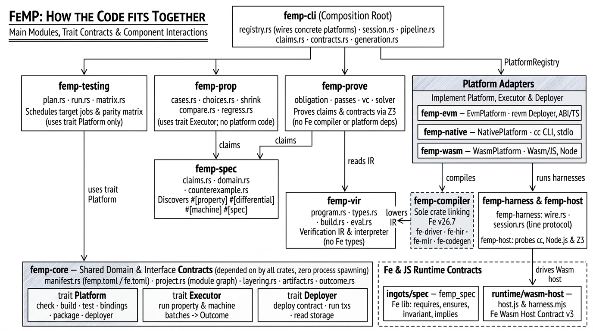

# FeMP

FeMP generates inputs, executes the same Fe property across targets, finds behavioral
divergences, minimizes counterexamples, and preserves them as regressions.

## The problem

Fe supports multiple compilation targets, but building an application across them involves
more than compiling the same code.

Developers need to organize shared logic, manage platform-specific implementations, and
establish that their programs behave consistently across environments.

A program that works on the EVM should not silently produce different results when compiled
natively or to WebAssembly.

## The approach

FeMP brings these concerns into one project.

- **Share logic.** Write reusable Fe code once and expose it through platform-specific modules.
- **Build everywhere.** Produce EVM contracts, native executables, and WebAssembly modules with
  generated bindings.
- **Test behavior.** Run shared tests and generated inputs across platforms, detecting
  inconsistencies and minimizing counterexamples.
- **Prove properties.** Use formal verification to establish correctness claims beyond
  individual test cases.

FeMP builds on the official Fe compiler. It does not replace the language or require a custom
dialect.

[Documentation](https://emeieiron.github.io/femp/) · [Quick start](docs/quick-start.md) ·
[FeMP and Fe](docs/fe-and-femp.md) · [Example project](examples/vesting)

## Demo

[](https://youtu.be/7vcoRUE7RIs)

▶ [Watch on YouTube](https://youtu.be/7vcoRUE7RIs) (4:35): a rate-limited treasury goes from
`femp doctor` to `femp prove`, then FeMP catches two planted bugs.

## Fe highlight

What makes FeMP possible at the language level is **Fe's capability-typed effect system
(`uses` / `with`), exclusive borrow discipline, and structured `contract` / `recv` semantics**:

- **Explicit effect & mutability boundaries (`uses`).** Every ambient dependency—storage
  (`store` vs. `mut store`), EVM context (`ctx: Ctx`), external calls (`call` vs. `mut call`),
  logs, or host I/O—must appear in `uses (...)`. This keeps shared ingots provably target-agnostic
  for cross-platform execution (`femp test`, `femp prop`) and tells `femp prove` statically which
  handlers read vs. mutate storage and where reentrancy can occur.
- **Scoped capability injection (`with`) and exclusive borrows.** Shared logic depends only on
  portable trait capabilities (such as `Clock`) while each target binds its native environment at
  the boundary via `with (...)`. Because Fe's borrow checker enforces exclusive `mut` access,
  `femp prove` lowers shared borrows to pure values and `mut` parameters / storage writes to
  copy-in/copy-out transitions—proving contracts in Z3 without a heap-aliasing model.
- **Typed `msg` / `recv` state machines & ordinary-Fe attributes.** Structured `recv` arms turn
  a contract directly into a state machine over its `store` struct, while Fe accepts FeMP's
  attributes (`#[property]`, `#[differential]`, `#[invariant]`, `#[spec]`) natively so the same
  Fe file compiles with `fe build`, runs across targets with `femp prop`, and verifies inductively
  with `femp prove`.

```fe
// examples/vesting/evm/src/lib.fe
pub contract Vesting uses (ctx: Ctx, log: mut Log) {
    mut store: VestingStore,

    recv VestingMsg {
        Claimed -> u64 uses (store) {
            store.claimed
        }

        Claim { amount } -> u64 uses (mut store, ctx, mut log) {
            let current = position(
                total: store.total,
                start: store.start,
                cliff: store.cliff,
                duration: store.duration,
                claimed: store.claimed,
            )
            let outcome = with (Clock = block_clock()) {
                vesting_core::claim_now(current, amount)
            }
            match outcome {
                Result::Ok(updated) => {
                    store.claimed = updated.claimed
                    log.emit(TokensClaimed { amount, total_claimed: updated.claimed })
                    updated.claimed
                },
                Result::Err(error) => revert_error(VestingFailed { code: error.code() }),
            }
        }
    }
}

/// The contract never pays out more than the schedule's total.
#[invariant]
fn claims_stay_within_total(store: VestingStore) -> bool {
    store.claimed <= store.total
}
```

## Architecture

`femp-cli` acts as the composition root, wiring `femp-testing`, `femp-prop`, `femp-prove`, and the platform adapters (`femp-evm`, `femp-native`, `femp-wasm`) around shared traits in `femp-core` (`Platform`, `Executor`, `Deployer`). Only `femp-compiler` links the Fe compiler crates directly, lowering functions into `femp-vir` for `femp-prove` while platform adapters delegate compilation to `femp-compiler` and harness execution to `femp-harness` and `femp-host`.



See [architecture](docs/architecture.md) for the full breakdown of crates, traits, and verification passes.

## Install

```sh
curl -fsSL https://github.com/emeieiron/femp/releases/latest/download/installer.sh | sh
```

## Create a project

```sh
femp new my-app && cd my-app
```

```text
shared/   the logic, its tests and specs
spec/     the femp_spec library that #[spec] functions use
evm/      a contract that exposes it
native/   a command-line program
wasm/     functions exported to JavaScript
```

## Test on every platform

```sh
femp test
```

```text
                            evm     native  wasm
    core::caps_the_rate     pass    pass    pass
    core::charges_the_rate  pass    pass    pass
    core::rounds_down       pass    pass    pass
```

A shared test that passes on one platform and fails on another fails the run.
[Testing](docs/testing.md)

## Test with generated inputs

Add a property to `shared/src/lib.fe`:

```fe
#[property]
pub fn fee_never_exceeds_the_amount(amount: u64, rate: u64) -> bool {
    fee(amount, rate) <= amount
}
```

```sh
femp prop
```

```text
PASS  core::fee_never_exceeds_the_amount  256 cases on evm, native, wasm
PASS  core::fee_spec                      256 cases on evm, native, wasm
```

A failure is shrunk to a minimal counterexample, saved under `regressions/` and replayed on
every run. [Property testing](docs/property-testing.md) ·
[Differential testing](docs/differential-testing.md)

## Prove it for every input

The template already states what `fee` promises:

```fe
#[spec]
pub fn fee_spec(amount: u64, rate: u64) -> u64 {
    let charged = fee(amount, rate)
    ensures(charged <= amount)
    charged
}
```

```sh
femp prove
```

```text
PROVED      core::fee_never_exceeds_the_amount  on evm, native, wasm
PROVED      core::fee_spec                      on evm, native, wasm
```

[Proving](docs/proving.md) · [Contracts](docs/contracts.md)

## Build and use it

```sh
femp build
./build/native/cli/my_app_cli 20000 250   # 500
```

```js
import { MyAppWeb } from "./build/wasm/web/my_app_web.js";

const app = await MyAppWeb.load();
app.fee(20000n, 250n); // 500n
```

Contracts get their bytecode, ABI and a typed TypeScript module. `femp package` collects every
output under `dist/` with SHA-256 hashes.
[Outputs and bindings](docs/bindings.md) · [Command line](docs/cli.md)

## Status

- `evm` is stable. `native` and `wasm` use Fe 26.7's experimental backends; native executables
  build on x86-64 Linux, AArch64 Linux and Apple silicon.
- Code the prover cannot model yet, such as strings, recursion and machines that deploy
  contracts, is reported as not supported. See [limits](docs/proving.md#limits).
- The Z3 that ships for Linux needs glibc 2.39 on x86-64 and 2.38 on ARM64, as on Ubuntu 24.04.
  On older systems such as Debian 12, install `z3` from the package manager for `femp prove`.
  See [installation](docs/installation.md).

## Develop

```sh
cargo install --path crates/femp-cli   # Rust 1.97 or newer
cargo test --workspace
```

[Architecture](docs/architecture.md) · [Adding a platform](docs/adding-a-platform.md)

## License

[Apache License 2.0](LICENSE). Release archives also include the Fe compiler (Apache 2.0)
and Z3 (MIT).
